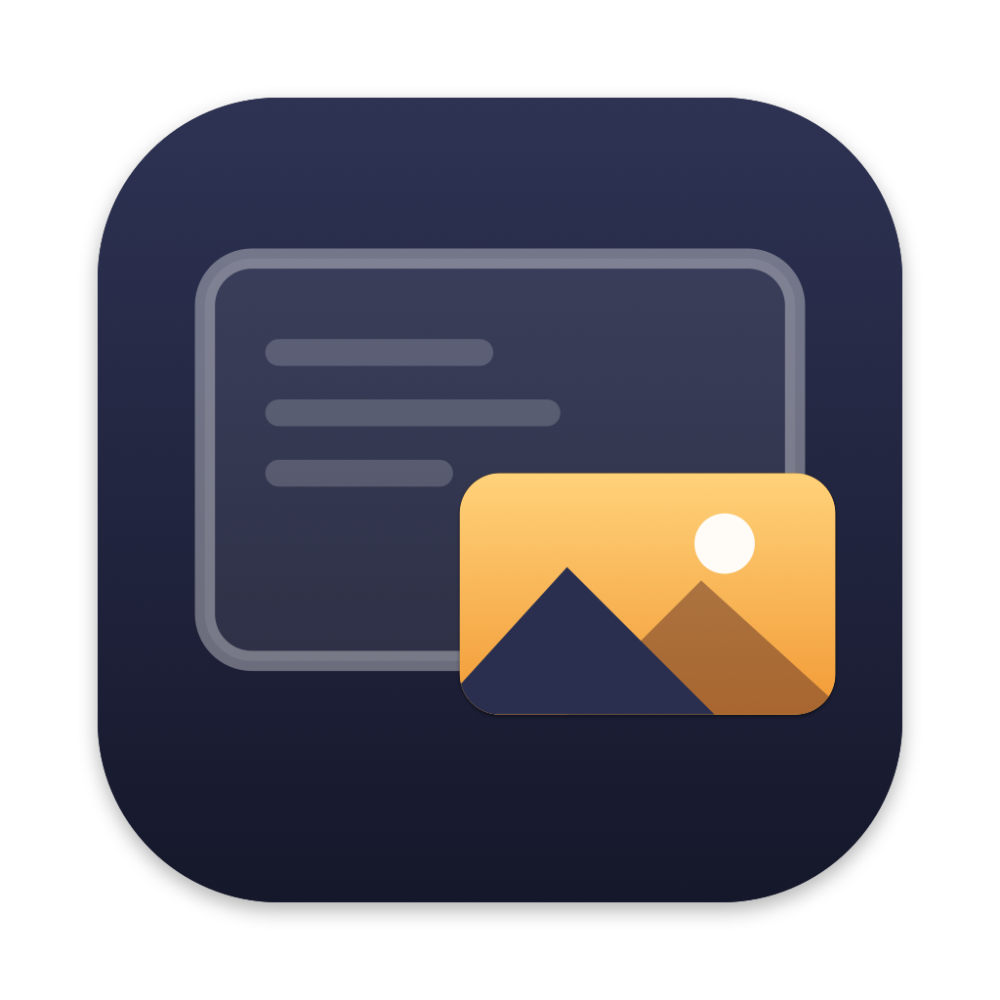

# Corner Cinema

[English](README.md) · **Français**

Lecteur vidéo pour macOS, pour ceux qui écoutent des films et des séries en travaillant.
On ajoute les services de streaming auxquels on est abonné, on s'y connecte une fois, et on
les regarde dans l'app.

> La version 0.1 (Swift + WebKit, tag `v0.1-webkit`) n'affichait pas la vidéo quand DisplayLink
> est actif. La version 0.2 passe à Chromium avec Widevine (Electron de castLabs).

## Installer

Il n'y a pas encore de téléchargement : construisez et installez l'app avec
`npm run install-app` (voir [Construire](#construire)). Elle va dans `/Applications`, où
Spotlight, Raycast et le Launchpad la trouvent. Elle fonctionne sur les Mac avec puce Apple,
macOS 14 ou plus récent.

L'app n'est pas signée par Apple. Sur un autre Mac que celui qui l'a construite, macOS
bloque le premier lancement : ouvrez *Réglages Système › Confidentialité et sécurité* et
cliquez *Ouvrir quand même*.

## Utilisation

- Corner Cinema ne contient aucun site.
- **Ajouter un service** (＋) : une adresse comme `example.com`, et un nom.
- Le service s'ouvre : se connecter sur sa propre page. La session est gardée sur ce Mac.
- Clic droit sur un service : le modifier, le déplacer, s'en déconnecter (oublier ses
  cookies) ou le retirer.
- Les fenêtres de connexion (« Continuer avec Google / Apple ») s'ouvrent dans une petite fenêtre.
- ⇧⌘H accueil, ⌘[ / ⌘] précédent / suivant, ⌘R recharger, ⌘, réglages.

## Mini lecteur

Pendant une vidéo, cliquer **Mini lecteur** (⇧⌘M), ou simplement passer à une autre app : la
page passe dans une petite fenêtre flottante, sans s'arrêter.

- Elle reste par-dessus toutes les apps, sur tous les bureaux, et par-dessus les apps en plein écran.
- Le lecteur du site s'affiche seul dans toute la fenêtre, avec ses propres commandes et
  sous-titres : Corner Cinema n'ajoute rien par-dessus la vidéo.
- Elle garde les proportions de la vidéo, s'aimante aux bords et aux coins de l'écran, et
  retient sa taille et sa place. Les *Réglages* (ou son clic droit) désactivent l'aimantation.
- **La glisser de n'importe où** pour la déplacer. Un simple clic reste un clic pour le site ;
  les barres de progression du site continuent de marcher.
- **Échap** (après un clic sur le lecteur) ramène la vidéo dans la fenêtre, sans l'arrêter.
- **Clic droit** pour les options : revenir à la fenêtre, fermer (met en pause), **Opacité**
  (paliers de 100 % à 40 % ; toute valeur dès 20 % avec le curseur des *Réglages*), **Son
  seulement** (une bande mince avec les commandes ; le film continue dessous), **Verrouiller**
  (les clics passent au travers ; ⌃⌥⌘T déverrouille).
- *Réglages › Passer au mini lecteur quand je vais dans une autre app* désactive le passage automatique.
- Le mini lecteur n'active pas Corner Cinema (il vous laisse dans votre travail) : la barre des
  menus montre donc les menus de l'autre app. L'**icône de la barre des menus** donne les
  commandes, la fenêtre et *Quitter*, depuis n'importe quelle app ; le clic droit du mini lecteur aussi.
- Les chaînes en direct (Pluto TV) repartent d'elles-mêmes après une pause : c'est le choix du site.

## Pubs

Pendant une pub, Corner Cinema coupe le son de la page, puis le remet quand le film revient.
Votre propre réglage du son reste tel quel. Rien n'est sauté, bloqué ni modifié sur le site :
la pub joue quand même, sans le son.

- Une pub est reconnue, dans la page et dans chacun de ses cadres, par :
  - son étiquette dans le lecteur (« Publicité 1 sur 2 », « Ad · 0:15 », « Advertisement »,
    « Votre vidéo reprendra après la pub ») ;
  - les classes qu'utilisent les lecteurs de pub courants (dont celui de YouTube) ;
  - les vidéos où le SDK de pub de Google (IMA) joue ses pubs (titre « Advertisement »), comme sur Plex ;
  - les cadres de serveurs de pub qui jouent une vidéo.
- « Pub · son coupé » s'affiche dans la barre d'outils, et un instant sur le mini lecteur.
- Une pub non reconnue : cliquer le mégaphone (ou ⌃⌥⌘A depuis n'importe quelle app, l'icône de
  la barre des menus, ou clic droit dans le mini lecteur). Le son revient tout seul après 3 min 30,
  une pause publicitaire de télé (les *Réglages* fixent la durée, ou « jusqu'au prochain appui »),
  ou au prochain appui. En attendant, une petite pastille au bas du mini lecteur fait le décompte ;
  un clic dessus remet le son.
- Les chaînes de télé en direct (une chaîne câblée diffusée par un fournisseur télé, par exemple)
  contiennent souvent les pubs de la diffusion d'origine dans le flux, sans aucun repère : seul le
  mégaphone y fonctionne.
- Pour un service dont les pubs passent toujours : *Modifier › Avancé › Repère de pub*, un
  sélecteur CSS d'un élément que le service n'affiche que pendant les pubs
  (*Présentation › Outils de développement de la page* aide à le trouver).
- *Réglages › Couper le son des pubs automatiquement* désactive ce comportement.
- **Musique pendant les pubs** (*Réglages*) : pendant qu'une pub joue sans le son, une radio joue à
  la place (un lien `.pls` ou `.m3u` comme `https://somafm.com/illstreet.pls`, ou l'adresse d'un
  flux), ou un fichier audio ou un dossier de musique. Elle entre et sort en fondu, et le film
  revient en fondu (les *Réglages* fixent la durée des fondus et le volume de la musique). Une
  radio reprend au direct ; les fichiers reprennent où ils s'étaient arrêtés. Vide : le silence.
- *Modifier › Avancé › Masquer sur ce service* masque ce que vous choisissez dans les pages d'un
  service (un sélecteur CSS), comme une bannière collée au bas de la page. Corner Cinema ne
  contient aucune règle de ce genre : c'est votre choix, service par service. Certains sites y
  voient un bloqueur de pub.

## YouTube

Les vidéos YouTube (`watch`, Shorts, `youtu.be`) jouent dans le lecteur intégrable de YouTube,
en mode confidentialité (`youtube-nocookie.com`, comme le Duck Player de DuckDuckGo) : pas de
cookies de suivi, pas de page autour de la vidéo, et l'API officielle du lecteur derrière les
commandes. La navigation sur YouTube (accueil, recherche, chaînes) reste le site normal ; ⌘[ y
revient.

- Une vidéo qui ne peut pas jouer hors de YouTube (choix de son propriétaire) s'ouvre sur sa page normale.
- YouTube Premium n'est pas reconnu dans ce lecteur : *Réglages › YouTube* garde la page normale.

## Raccourcis depuis n'importe quelle app

| Action | Raccourci |
| --- | --- |
| Lecture / Pause | ⌃⌥⌘P |
| Reculer / avancer de 10 secondes | ⌃⌥⌘J / ⌃⌥⌘L |
| Couper / remettre le son | ⌃⌥⌘M |
| C'est une pub (son coupé jusqu'au prochain appui) | ⌃⌥⌘A |
| Verrouiller / déverrouiller le mini lecteur | ⌃⌥⌘T |
| Afficher / masquer le mini lecteur | ⌃⌥⌘H |

## DisplayLink

Quand DisplayLink est actif, la vidéo affichée par la puce graphique reste noire sur tous les
écrans, avec le son seulement, et macOS bloque les vidéos protégées.

- Corner Cinema vérifie au lancement : si DisplayLink est actif, l'accélération matérielle est
  coupée et Chromium décode et affiche la vidéo lui-même. La vidéo s'affiche, Netflix compris
  (en 720p au plus), au prix de plus de travail pour le processeur.
- DisplayLink démarré après l'app : un avis dans la barre d'outils propose de redémarrer.
- *Réglages › Accélération matérielle* : Automatique (par défaut), Activée ou Désactivée.

## Limites connues

- **La connexion Google** (« Se connecter avec Google », comptes YouTube) est refusée : Google
  bloque la connexion dans les navigateurs intégrés aux apps. Connectez-vous par courriel et mot
  de passe quand le service le permet. YouTube joue sans compte.
- **Netflix** joue en 720p au plus sans accélération matérielle (avec DisplayLink), comme dans Chrome.
- Un service qui ne joue que dans Safari (FairPlay seulement, sans Widevine) ne joue pas.
- **Les chaînes en direct** (Pluto TV) repartent d'elles-mêmes après une pause.

## Confidentialité

- Pas de compte, pas de statistiques, pas de télémétrie : Corner Cinema ne collecte rien. Ses
  seules connexions sont les sites que vous ouvrez et le service de mise à jour de Google pour le
  module Widevine.
- Les services, réglages, icônes des sites, cookies et connexions restent sur le Mac, dans
  `~/Library/Application Support/Corner Cinema`.
- Chaque service est le site du service lui-même, utilisé avec votre propre compte.

## Construire

Prérequis : macOS 14+, Node.js 20+, Python 3.

```bash
git clone https://github.com/spoulin/Corner-Cinema.git
cd Corner-Cinema
npm install
node node_modules/electron/install.js   # télécharge l'Electron de castLabs, si npm ne l'a pas fait
npm run evs:setup                       # outil EVS de castLabs, dans .evs
```

Widevine demande une signature VMP, que Netflix et d'autres vérifient. Elle vient du service
gratuit EVS de castLabs, avec votre propre compte :

```bash
.evs/bin/python -m castlabs_evs.account signup   # la première fois ; ensuite `reauth` quand elle expire
npm run evs:sign-dev                             # signe node_modules/electron pour `npm start`
```

Ensuite :

- `npm start` : lance l'app depuis les sources.
- `npm run app` : construit `dist/mac-arm64/Corner Cinema.app` (signé VMP, puis signé localement pour ce Mac).
- `npm run install-app` : construit l'app et l'installe dans `/Applications` (en quittant d'abord
  la copie ouverte). Vos services, réglages et connexions restent : ils ne sont pas dans l'app.
- `npm run dist` : construit un `.dmg` et un `.zip`.

Les gens qui téléchargent une app construite n'ont besoin d'aucun compte : la signature est
dans l'app, et le module Widevine se télécharge depuis Google au premier lancement.

## Fonctionnement

- `src/main/main.js` : démarrage (accélération matérielle, Widevine), menus, réglages, messages.
- `src/main/main-window.js` : la fenêtre principale ; chaque service ouvert est une
  `WebContentsView` sous la barre d'outils, dans une session gardée (`persist:services`). Elle pilote la vidéo.
- `src/main/mini-player.js` : le panneau flottant où passe la page ; sa barre « son seulement »
  et ses messages sont dans `src/renderer/mini.*`.
- `src/preload/page.js` : tourne dans chaque page de service et dans chacun de ses cadres, dans un
  monde que le site ne peut ni voir ni appeler : repère les pubs ; dans le cadre principal, trouve,
  décrit et pilote la vidéo principale, marque le lecteur du site, déplace le mini lecteur quand on
  le glisse et envoie les vidéos YouTube au lecteur confidentialité. `src/page/focus.css` affiche le
  lecteur seul. Rien d'autre n'est caché dans la page (les sites vérifient que leurs éléments de
  pub restent visibles).
- `src/main/youtube.js` : les adresses YouTube et la page du lecteur confidentialité.
- `src/main/store.js` : services, icônes et réglages, en JSON dans le dossier de l'app.
- `src/main/displaylink.js` : savoir si DisplayLink est actif.
- `src/renderer/` : la barre d'outils, l'accueil, l'éditeur de service et les réglages (HTML, sans framework).
- `src/preload/ui.js` : la petite API des fenêtres de l'app. Les pages des services ne peuvent pas l'atteindre.
- `scripts/evs.js` : la signature VMP (avant la signature Apple, comme macOS l'exige).

L'interface est en anglais, et en français quand le Mac est en français (`src/i18n/fr.json`).

## Licence

[MIT](LICENSE). Electron for Content Security de castLabs ; le module Widevine est celui de
Google, téléchargé au premier lancement.

Corner Cinema n'est affilié à aucun service de streaming, ni approuvé par aucun. Les noms de
services cités ici appartiennent à leurs propriétaires et décrivent seulement le comportement de
l'app avec eux. Corner Cinema ne contourne aucune protection contre la copie : les vidéos
protégées passent par Widevine, comme dans Chrome.
